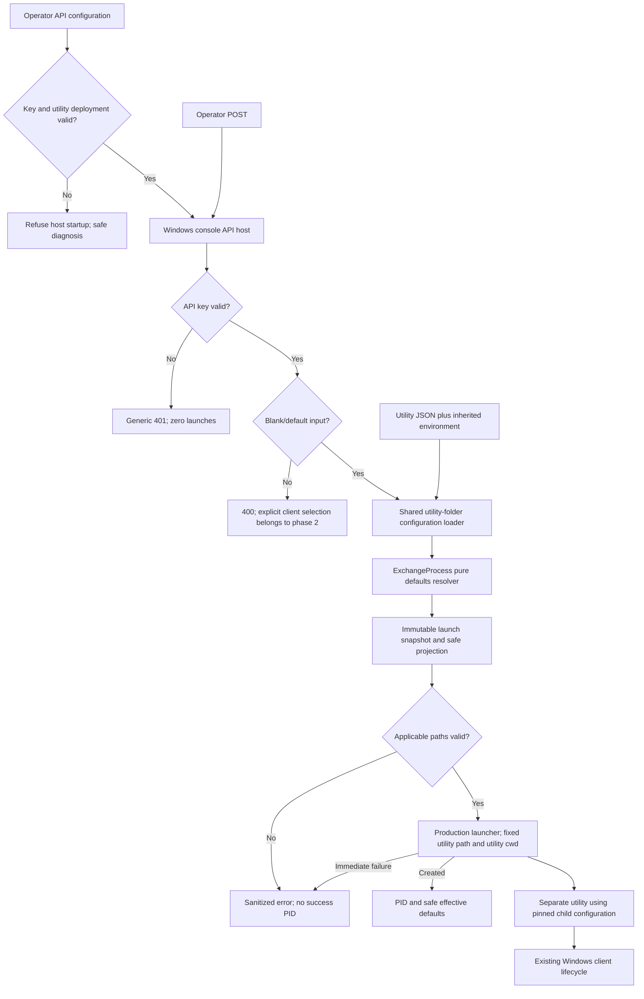

# Phase 01: Authenticated Default Launch - Research

**Researched:** 2026-10-31
**Domain:** ASP.NET Core admin API, Windows child-process launch, shared utility configuration
**Confidence:** MEDIUM for external documentation; HIGH for explicitly quoted source observations

<user_constraints>
## User Constraints (from CONTEXT.md)

The following decision and deferred sections are copied verbatim. Source: phase context read this session. DATA_c94e7f13_START

## Implementation Decisions

### API-key operation
- **D-01:** Callers send the API key in the `X-Api-Key` header.
- **D-02:** Refuse API startup if the configured server key is missing or blank.
- **D-03:** Resolve the server key through standard ASP.NET Core configuration sources, including deployment-managed JSON and environment overrides. Do not restrict deployment to environment variables alone. Never commit key values; protected environment files remain user-maintained.
- **D-04:** Missing and invalid caller keys receive the same generic `401 Unauthorized` response. Never echo the supplied key. Authentication failure causes zero process launches.

### Deployment and configuration
- **D-05:** Initially run the API manually as a console application on Windows. Windows Service and IIS hosting are not requested for this phase.
- **D-06:** Configure the full path to a separately published `Exchange.exe`. The API does not assume the utility is deployed alongside it. This utility target is distinct from the optional external-client path planned for Phase 2.
- **D-07:** Read effective exchange settings from the utility deployment folder, following its existing configuration order: `embeddedsettings.json`, `appsettings.json`, then inherited environment overrides. Use the utility folder as the child working directory. API resolution and child execution must agree; do not maintain separate API exchange settings or default definitions.
- **D-08:** Refuse API startup if the configured utility executable or required configuration files are missing. Report the deployment problem without exposing secrets. This validation must not execute exchange or invoke client cleanup.

### Carried-forward requirements
- **D-09:** Default definitions remain in `ExchangeProcess`. Omitted, null, empty, and whitespace-only executable input all select existing defaults.
- **D-10:** Blank-input responses report effective client filename, full executable path, client working directory, input/output directories, and timeout in milliseconds, excluding credentials and API keys. Client working directory is distinct from the utility working directory.
- **D-11:** Return the utility PID after process creation without waiting for exchange completion. A PID is a launch acknowledgement, not evidence of successful exchange.
- **D-12:** Allow overlapping requests without rejecting, queueing, or serializing solely because another exchange is running. Shared named events and broad process cleanup remain concurrency concerns; independent successful external exchanges are not guaranteed.
- **D-13:** Use isolated substitutes and test-owned processes for verification. Do not run real exchange or terminate installed clients. Preserve named-event identifiers and external client argument order unless separately approved.

### Open choices for planning
The user selected API-key operation and deployment/configuration for discussion. Endpoint naming, request/response shape, configuration key names, and detailed launch-error formatting were not selected or decided. Resolve these during planning consistently with the approved requirements; do not describe them as user-approved choices. No explicit "you decide" answer was selected.

## Deferred Ideas

None introduced during discussion. Explicit client selection remains in Phase 2 as already planned. Endpoint naming, response shape, and error formatting are open planning choices within Phase 1, not deferred capabilities.

DATA_c94e7f13_END
</user_constraints>

## Project Constraints (from AGENTS.md)

[VERIFIED: AGENTS.md, read this session] Planning must enforce all actionable repository directives:

- Work from the repository root; preserve unrelated edits and untracked IDE files. Stage only intended changes. Local commits are allowed when requested; obtain approval for every push. This research is not committed by the researcher.
- Never modify, delete, move, regenerate, or print protected environment files; only blank-valued examples are permitted. Never rename files or directories or simulate a rename through copy/delete.
- Never run real exchange or installed-client cleanup without an explicitly authorized integration environment. Only isolated substitutes and test-owned processes are allowed here.
- Use the project test skill after implementation changes, follow the test rules, and run the complete solution tests before declaring code complete. Report actual failures/blockers honestly.
- Use project-scoped memory with progressive disclosure, search before saving, and retain concise verified facts without credentials, settings values, or transcripts. Historical memories yield to current instructions and source.
- Keep credentials and tokens out of documentation, logs, tests, reports, responses, and Git. Deployment secrets are user-maintained. Use environment overrides for local credentials.
- Follow existing C# four-space indentation, Allman braces, block namespaces, PascalCase public members, camelCase locals, system-first usings, UTF-8/CRLF, and Async suffixes. Preserve Russian comments/messages.
- Preserve existing external protocol identifiers and argument order. Keep timeout semantics in milliseconds. Validate NLog configuration if changing its configuration or versions; do not change either for this phase.
- Do not assume development JSON is loaded by the utility; keep configuration precedence and utility working-directory behavior. Do not commit generated build output or logs.
- Run `langwatch ingest context` when entering a different repository, branch, or worktree. This research stays in the current checkout.
- Apply the PR review skill only for an explicit PR review request. It is not applicable to this research.

[VERIFIED: .codex/rules/unit-tests.md, read this session] New tests belong in the existing test project and namespace; use xUnit facts/theories, Arrange/Act/Assert, behavioral assertions, independently owned temporary files, bounded waits, deterministic signals, and guaranteed cleanup. Do not mutate process-global environment in parallel tests, use arbitrary sleeps, or use real networks/services/clients. The proposed loopback HTTP host is test-owned infrastructure, not an external network dependency.

## Summary

[VERIFIED: Exchange/Program.cs:21-31] The entry point composes configuration and then constructs orchestration. Verbatim source, DATA_2d0587a4_START: `AddJsonFile("embeddedsettings.json")`, `AddJsonFile("appsettings.json")`, `AddEnvironmentVariables()`, `new ExchangeProcess(logger, exchangeOptions)`, `exchangeProcess.StartExchangeProcess();` DATA_2d0587a4_END. Extract the configuration composition into a side-effect-free shared loader; never call orchestration to inspect defaults.

[VERIFIED: Exchange/ExchangeProcess.cs:15-27,85-108,168-180] Existing default and protocol definitions are verbatim, DATA_18af0c6b_START: `private const string ExchangeProcessName = "ExchangeClient";`, `private const string ExchangeProcessFileName = ExchangeProcessName + ".exe";`, `"CloseExchng"`, `"OneTimeExchng"`, `"ExchngEnd"`, `"LoadEnd"`, `StopClients();`, `process.Kill();` DATA_18af0c6b_END. The existing lifecycle starts with broad process cleanup and uses shared named events. Admit overlap at the API without promising independent client exchanges or changing the protocol.

**Primary recommendation (research judgment):** Build a thin controller-based web application on the existing framework; reference the utility assembly for pure configuration/default resolution, snapshot each launch once, and inject a small production process launcher. Ship an authenticated HTTP-to-harmless-child tracer before broadening the matrix. Add no database, UI, queue, status endpoint, framework migration, or real exchange execution.

## Architectural Responsibility Map

The following is a proposed responsibility allocation, not a claim that these components already exist.

| Capability | Primary Tier | Secondary Tier | Rationale |
|---|---|---|---|
| API-key check and HTTP errors | API / Backend | ASP.NET Core host | Authentication before configuration disclosure or launch |
| Utility deployment validation | API / Backend | Filesystem | Fail before serving requests for invalid deployment |
| Effective exchange configuration | Shared utility code | API / Backend | One composition order consumed by both entry points |
| Default client selection | ExchangeProcess pure resolver | Shared utility code | Class retains default ownership |
| Child creation and immediate PID | API process launcher | Windows OS | Launch utility outside web process |
| Actual exchange/client lifecycle | Separate utility process | Windows client | Remains outside HTTP request and outside routine tests |
| Safe defaults response | API DTO projection | Shared immutable launch snapshot | Explicit allowlist, no serialization of credential-bearing options |

<phase_requirements>
## Phase Requirements

Descriptions are copied from the approved requirements; support is prescriptive research judgment.

| ID | Description | Research Support |
|---|---|---|
| API-01 | An operator can call an admin POST endpoint hosted in a separate ASP.NET Core application. | Separate controller application and real HTTP tracer |
| AUTH-01 | An operator must provide a valid API key; missing or invalid keys are rejected before any process is launched. | Framework authentication handler, authorization policy, counting launcher |
| AUTH-02 | Missing server API-key configuration prevents anonymous access to the launch endpoint. | Eager options validation; missing/blank key host-start failures |
| EXEC-01 | An authorized operator can launch the configured `Exchange.exe` as a separate operating-system process. | Fixed configured path and production launcher tested with substitute executable |
| EXEC-03 | Omitted, null, empty, or whitespace-only executable input selects the existing defaults. | Blank normalization and shared pure resolver matrix |
| EXEC-04 | An operator receives the launched utility process ID immediately after process start, without waiting for exchange completion. | Response while test child remains alive; no completion await |
| EXEC-05 | An operator can submit overlapping launch requests; an existing exchange process does not by itself cause a request to be rejected or queued. | Concurrent requests while first substitute is alive; two acknowledgements |
| DEF-01 | Default definitions remain in `ExchangeProcess` and are shared with API resolution rather than copied into the API. | Class-owned static/pure resolution used by console and API |
| DEF-02 | For blank executable input, the operator receives the effective client filename, full executable path, client working directory, input/output directories, and timeout in milliseconds, excluding credentials. | Dedicated non-secret DTO from same snapshot used for launch |
| ERR-01 | An operator receives useful errors for invalid executable paths and immediate process-start failures without disclosure of secrets. | Deployment startup guard, request preflight, narrow sanitized launch-error mapping |
</phase_requirements>

## Standard Stack

Keep existing versions; these are source-verified project versions, not claims about latest registry releases.

| Component | Version / source | Purpose |
|---|---|---|
| .NET / ASP.NET Core | Existing target verbatim DATA_651a38de_START: `<TargetFramework>net8.0</TargetFramework>` DATA_651a38de_END [VERIFIED: Exchange/Exchange.csproj:3-7; Tests/Exchange.Tests.csproj:2-8] | New web project uses same target with Web SDK; no migration |
| Framework authentication, options, JSON and DI | Framework supplied | Use authentication handler/policy, eager options validation, explicit DTOs [CITED: https://learn.microsoft.com/en-us/aspnet/core/security/authentication/?view=aspnetcore-8.0] |
| Process / filesystem APIs | Framework supplied | Fully qualified executable target and direct launch [CITED: https://learn.microsoft.com/en-us/dotnet/fundamentals/runtime-libraries/system-diagnostics-processstartinfo-useshellexecute] |
| Existing test packages | Verbatim DATA_42b1e675_START: `Microsoft.NET.Test.Sdk` / `17.14.1`, `xunit` / `2.9.3`, `xunit.runner.visualstudio` / `3.1.5` DATA_42b1e675_END [VERIFIED: Tests/Exchange.Tests.csproj:9-16] | Retain existing test infrastructure |
| Existing logging dependencies | Verbatim DATA_c741b825_START: `NLog` / `6.0.4`, `NLog.Web.AspNetCore` / `6.0.4` DATA_c741b825_END [VERIFIED: Exchange/Exchange.csproj:17-20] | Preserve utility logging; API can use framework logging |

**Installation recommendation:** No new external packages. Add web and test-helper projects with framework/project references; reuse existing packages. No registry freshness or package publish-date claims are made. Existing package upgrades are outside scope.

### Package Legitimacy Audit

Not triggered: this recommendation adds no external package. Framework references are not third-party package installs. If the planner elects to add a testing package, run the legitimacy gate and correct NuGet-registry verification first; do not silently add dependencies. Microsoft's documented WebApplicationFactory approach adds a testing package, so the recommendation below uses a test-owned loopback Kestrel host instead. [CITED: https://learn.microsoft.com/en-us/aspnet/core/test/integration-tests?view=aspnetcore-8.0]

## Architecture Patterns

### System Architecture Diagram

Proposed flow:



### Recommended Component Responsibilities and File Changes

All paths in this table are **proposed changes**, not assertions that files already exist or have been created. No existing path is renamed.

| Proposed file/change | Responsibility | Closest source analog for pattern mapper |
|---|---|---|
| Add `Exchange.Api/Exchange.Api.csproj` | Separate Web SDK project targeting existing framework; reference utility assembly | Existing application project |
| Add `Exchange.Api/Program.cs` and small app composition helper | Standard API configuration, DI, authentication, controller mapping; injectable composition for tests | Existing entry point, but no orchestration |
| Add `Exchange.Api/Controllers/ExchangeController.cs` | Authenticated POST; blank normalization; safe response/error mapping | New HTTP boundary |
| Add `Exchange.Api/Authentication/ApiKeyAuthenticationHandler.cs` | Single header value, ordinal exact credential check, generic challenge | Framework authentication pattern |
| Add `Exchange.Api/Options/ApiOptions.cs` | API-owned key and fixed utility path only; startup validation | Existing options models |
| Add `Exchange.Api/Services/UtilityProcessLauncher.cs` and launcher interface | Direct start, PID capture, disposal of local handle, sanitized failures | Existing process construction; existing test process pattern |
| Add `Exchange.Api/Contracts/LaunchRequest.cs` and safe response type | Explicit HTTP contract; credentials never included | New boundary DTOs |
| Add `Exchange/Configuration/ExchangeConfigurationLoader.cs` | Explicit directory, exact utility provider order; injectable environment dictionary in tests | Existing configuration builder |
| Add `Exchange/ResolvedExchangeSettings.cs` (name provisional) | Immutable resolved settings with explicit safe projection boundary | Existing options models |
| Edit `Exchange/ExchangeProcess.cs` | Pure class-owned default resolver and consume same resolved fields in client start | Existing constants and client creation |
| Edit `Exchange/Program.cs` | Call shared loader/resolver; keep console lifecycle and failure convention | Existing entry point |
| Edit existing solution and test project | Add web/helper references; stage helper output without deployment secrets | Existing test staging target |
| Add `Tests/ExchangeApiTests.cs`, `Tests/ExchangeConfigurationTests.cs`, `Tests/UtilityProcessLauncherTests.cs` | HTTP, configuration contract, real launcher isolation | Existing test namespace and process test |
| Add `Tests/Fixtures/HarmlessUtility/HarmlessUtility.csproj` and `Program.cs` | Package-free executable that reports only synthetic safe observations and waits for test release | Test-owned process pattern |
| Add API configuration example and `docs/exchange-api.md`; edit test README | Blank key, configured target, manual Windows hosting, default request and PID semantics | Existing documentation conventions |

Recommendation: a project reference to the existing utility assembly is the smallest shared-code boundary. Merely referencing an assembly must not invoke its entry point; keep all reusable resolution pure. Do not create a shared library by moving existing files. A later extraction would need to honor the no-renames rule.

### Pattern 1: Separate Configuration Domains

ASP.NET Core default host configuration supports JSON, environment, and command-line sources; utility configuration is explicitly composed and must remain distinct. Use ordinary web-host configuration for the API key and utility target, then an explicit shared loader rooted at the configured utility folder for exchange settings. Validate API options at host start. [CITED: https://learn.microsoft.com/en-us/aspnet/core/fundamentals/configuration/?view=aspnetcore-8.0] [CITED: https://learn.microsoft.com/en-us/aspnet/core/fundamentals/configuration/options?view=aspnetcore-8.0]

Proposed contract choices for planning: POST `/admin/exchanges`, optional `ExchangeProcessFileName` field, API settings `AdminApi:ApiKey` and `AdminApi:UtilityPath`, success HTTP 200 containing `processId` and a nested safe defaults object. These are researcher recommendations, **not locked user choices**. Empty body, empty JSON object, explicit null, empty string and whitespace should all resolve default input. Reject a nonblank override explicitly in Phase 1, rather than ignoring it or executing it prematurely.

### Pattern 2: One Immutable Snapshot per Launch

Recommendation:

1. Authenticate before binding sensitive deployment operations. No resolver/launcher calls for unauthorized requests.
2. Build child ProcessStartInfo and materialize its inherited environment exactly once. Pass that captured dictionary into the shared utility loader rather than rereading live process-global environment.
3. Load utility JSON in the existing order, overlay captured environment, validate structure, then resolve defaults through the pure method owned by ExchangeProcess.
4. Resolve relative configured filesystem paths against the utility deployment folder; return absolute executable and client working-directory paths. Pass the exact resolved values into both console execution and API projection.
5. Freeze one immutable launch object. Its public DTO is a six-field allowlist; never serialize the credential-bearing options or snapshot.
6. Pin every consumed exchange option leaf into **child-specific** environment overrides. Include sensitive leaves only in memory; never command line, fixture output, request, response, or logging.
7. Start with the fixed configured utility path and utility folder working directory. Return PID from that launch plus the safe projection of that same object.

The environment dictionary initializes from the current process and can then be altered for only the child; the .NET 8 implementation was read directly. [CITED: https://raw.githubusercontent.com/dotnet/runtime/v8.0.0/src/libraries/System.Diagnostics.Process/src/System/Diagnostics/ProcessStartInfo.cs]

[VERIFIED: Exchange/Options/ExchangeOptions.cs:11-31; Exchange/Options/AgentOptions.cs:11-21] Complete currently consumed option names, verbatim DATA_217edc98_START: `SectionName = "Exchange"`, `OutFilePath`, `InFilePath`, `AgentCatalog`, `Agent`, `Timeout`, `Login`, `Password` DATA_217edc98_END. Use these existing leaves when pinning the snapshot; the API must not introduce separate exchange defaults.

**Race boundary:** Pinning overrides prevents later valid JSON value edits from changing the child's selected effective settings. It does not make later deleted/malformed required JSON readable. [ASSUMED: A1] Deployment assets remain present and parseable during child startup. A successful PID is still only process creation acknowledgement; a later parse failure is a child failure. Do not claim an atomic transaction across filesystem mutation and Process.Start. Test JSON edits after resolution with synthetic data to distinguish these guarantees.

### Pattern 3: Launch Acknowledgement, Not Job Management

Use a fully qualified FileName, explicit WorkingDirectory, UseShellExecute=false, and no shell or caller-built command text. With shell execution disabled, working directory does not locate the executable, so setting only cwd and a relative filename is insufficient for this design. [CITED: https://learn.microsoft.com/en-us/dotnet/fundamentals/runtime-libraries/system-diagnostics-processstartinfo-useshellexecute]

Capture Process.Id immediately after successful creation. Do not wait for exit, named events, readiness, or redirected output. Close/dispose the local process wrapper without terminating the launched utility. Do not redirect pipes unless a bounded lifecycle owner drains them. Keep no global running flag, semaphore, queue, or shared mutable per-request snapshot. [CITED: https://learn.microsoft.com/en-us/dotnet/api/system.diagnostics.process.start?view=net-8.0] [CITED: https://devblogs.microsoft.com/dotnet/process-api-improvements-in-dotnet-11/] Use only APIs available to the existing target; the blog's newer convenience APIs are not recommendations.

### Pattern 4: Startup Validation and Safe Errors

Recommendation: reject absent/blank key; absent, malformed, non-fully-qualified, directory-valued or missing utility executable; missing required JSON/NLog assets; malformed configuration; absent nested options; invalid usable timeout; invalid resolved client path before launch. Validate safe deployment prerequisites without instantiating orchestration, initializing utility logging, touching events, or enumerating/killing clients.

[VERIFIED: Exchange/Program.cs:16-24; Exchange/Exchange.csproj:14,23-28] Required named assets are quoted verbatim DATA_909a8fb2_START: `"exchangeNlog.config"`, `"embeddedsettings.json"`, `"appsettings.json"` DATA_909a8fb2_END. Additionally verify framework-dependent publish artifacts during a controlled publish-output smoke check; do not invent an exhaustive deployment manifest from guessed filenames.

Recommendations for mapping: invalid request/nonblank unsupported override -> 400; missing/invalid caller key -> identical 401; invalid operator deployment -> fail host startup; deployment disappearance or immediate OS start failure after startup -> sanitized 500 ProblemDetails with stable code and trace identifier. Do not return raw exception.Message, inner exceptions, configuration parser snippets, environment dumps, full options, command text, or child stderr. Return a useful safe problem category and affected logical field. A successful preflight is not proof Process.Start will succeed; catch the immediate OS error too. Framework ProblemDetails provides a standard error envelope. [CITED: https://learn.microsoft.com/en-us/aspnet/core/fundamentals/error-handling-api?view=aspnetcore-8.0]

### Anti-Patterns to Avoid

- API calls orchestration to discover defaults: reaches global cleanup.
- API repeats filename constants or loads exchange settings from API JSON: produces drift.
- API computes response after starting from a second configuration read: breaks snapshot agreement.
- API logs options records using generated ToString: risks credentials.
- Sharing a mutable ProcessStartInfo or options object across requests: crosses snapshots.
- Awaiting child completion or holding admission lock: violates immediate PID / overlap decisions.
- Arbitrary path substring bans: confuse valid Windows paths with shell command injection; direct configured target and framework canonicalization are the boundary.
- “Fixing” global event or cleanup behavior in this phase: broadens protocol/lifecycle scope.

These are planning recommendations grounded in the quoted existing lifecycle and the locked requirements.

## Don't Hand-Roll

| Problem | Don't Build | Use Instead | Basis |
|---|---|---|---|
| Config provider precedence | Custom JSON merging/dotenv reader | Explicit framework configuration builder | Existing provider chain; Microsoft configuration docs |
| Authentication integration | Ad hoc key check inside controller action | Small framework authentication handler and authorization policy | Microsoft authentication docs |
| Secret comparison | Custom timing loop | Framework fixed-time byte comparison; do not trim/change supplied secret | Framework comparison API [CITED: https://learn.microsoft.com/en-us/dotnet/api/system.security.cryptography.cryptographicoperations.fixedtimeequals?view=net-10.0] |
| Safe serialization | Serialize all options and remove fields later | Explicit allowlisted DTO | Locked non-secret response requirements |
| Process execution | Shell scripts/string concatenation | ProcessStartInfo and direct OS process start | Microsoft process docs |
| HTTP test server packages | New bespoke HTTP server | Test-owned Kestrel host using production composition | Microsoft Kestrel docs |

## Runtime State Inventory

This is a narrow shared-code refactor plus new API. No rename/migration is authorized.

| Category | Evidence / limits | Plan action |
|---|---|---|
| Stored data | No datastore modification is required by the scoped design; no live datastore inspection performed. | No data migration; do not invent one |
| Live service config | Manual Windows console hosting and independently deployed utility are locked decisions. Actual deployment not inspected. | Document API settings and utility path; user supplies deployment secrets manually |
| OS-registered state | Service/IIS registration is out of scope. No scheduler/service inventory performed or claimed. | No registration/migration task |
| Secrets/env vars | Existing option names quoted above; environment overrides are runtime inputs. Values intentionally unread. | No secret-file edits or renames; use child-only snapshot overrides |
| Build artifacts | Existing copy target stages executable dependencies into a test folder: verbatim DATA_036a9bf4_START: `DestinationFolder="$(OutDir)ExchangeApp"` DATA_036a9bf4_END [VERIFIED: Tests/Exchange.Tests.csproj:18-24] | Publish/rebuild utility and API; stage helper dependencies separately; never commit generated output |

## Common Pitfalls

1. **Utility cwd confused with client cwd.** Keep two explicit absolute directories in the launch model. Only the former is ProcessStartInfo.WorkingDirectory for the API child.
2. **Startup validation triggers side effects.** Never construct/call orchestration or configure utility NLog while checking deployment. Unit-test validation with fake launcher call count zero.
3. **Authorization tested by bypassing real authentication.** Replace the launcher, not authentication; exercise the actual header handler for missing/wrong/duplicate/blank keys.
4. **Malformed-body responses leak before auth.** Authorization middleware must protect the route before controller model binding; unauthorized malformed JSON must still yield generic 401 with no launches.
5. **Immediate-process-exit reclassified as launch failure.** A child may exit immediately after successful creation; do not add readiness probes, ExitCode waits, or exchange-status claims.
6. **Fake launcher proves only controller wiring.** Pair fast HTTP tests with at least one real production-launcher-to-harmless-helper tracer.
7. **Parallel tests mutate environment or cwd.** Inject dictionaries/base directories; pass child-specific environment. Never set global current directory or process environment.
8. **Blank variants incompletely specified.** Cover missing body, JSON null, empty object, omitted property, property null, empty and whitespace; explicitly configure model binding to accept the chosen variants.
9. **Noisy diagnostics expose secrets.** Use synthetic sentinel secrets only in memory in tests and assert absence from serialized success/error/log output.
10. **Stale deployment of utility assembly.** Publish the updated utility and API together from the same revision; an older external utility may not share the resolver behavior. Document deployment compatibility and verify a publish smoke test.

These are implementation risks/recommendations derived from the requirements and inspected source, not claims that proposed bugs already exist.

## Code Examples

No implementation code is produced by this research assignment. The following executable-free sequence specifies the boundary the planner should implement:

```text
request -> real authentication -> normalize blank input
        -> capture child environment -> shared utility configuration loader
        -> class-owned pure default resolver -> immutable launch snapshot
        -> validate applicable paths -> production launcher.Start(snapshot)
        -> return launched PID + snapshot.SafeDefaults
```

[VERIFIED: Tests/ProgramEndToEndTests.cs:13-14,35-60] Existing safe test pattern creates a unique directory, supplies explicit child cwd/environment/arguments, reads redirected streams asynchronously, imposes cancellation, and kills only its test-owned process on timeout. Its directory creation is verbatim DATA_3a27edb0_START: `Directory.CreateDirectory(testDirectory);` DATA_3a27edb0_END. Reuse the ownership/timeout pattern, but do not launch the real utility in new API tests. The helper must report safe synthetic fields only and remain alive until a test-owned release signal.

## State of the Art

[CITED: https://learn.microsoft.com/en-us/aspnet/core/test/integration-tests?view=aspnetcore-8.0] Microsoft documents factory-based HTTP integration tests and replacement dependencies. That remains an optional alternative if the planner approves a new test package; real loopback Kestrel achieves this slice's needed observable HTTP boundary with the existing shared framework.

[CITED: https://asvs.owasp.org/] ASVS 5.0.0 was published 30 May 2025. Its chapter numbering differs from older GSD templates. Use the versioned mapping below rather than labeling Authentication as V2.

No framework modernization is recommended. No “latest package” or support-window assertion is inferred from documentation banners.

## Assumptions Log

| # | Claim | Section | Risk if Wrong |
|---|---|---|---|
| A1 | [ASSUMED] Deployment assets remain present and parseable while a launched utility reads them. | Snapshot pattern | Child may acknowledge creation then fail; pinning values does not make missing/malformed files usable. Document this launch-only limit, or explicitly plan an internal snapshot-input protocol if stronger atomicity is required. |

Other route, class, file and DTO names in this document are proposed implementation choices, not assumed facts or locked user approvals.

## Open Questions

1. **HTTP and configuration names:** Not user-locked. Planner should adopt or refine the concrete proposed contract and record it as a planning decision.
2. **Full atomic configuration handoff:** Default recommendation pins all consumed leaves in child environment. If the plan requires successful startup under concurrent malformed/deleted deployment files, it needs an explicit internal snapshot transport consumed by the console, rather than claiming environment overlays solve file parsing.
3. **Deployment access:** The real utility folder, host identity, certificate and permissions were not inspected. Startup guards and deployment instructions must diagnose these safely. This is not a blocker to implementation with isolated fixtures.
4. **Relative/UNC configuration paths:** Canonicalize against utility cwd consistently; test synthetic Windows cases. Phase 2 owns explicit caller-selected client path policy and lifecycle compatibility.

## Environment Availability

[VERIFIED: dotnet --info, executed 2026-10-31] Observed Windows x64; SDKs 8.0.414 and 10.0.403; ASP.NET Core runtime 8.0.33 and .NET runtime 8.0.33 present. The current SDK can parse the solution format per repository guidance. No actual utility or external client was run.

| Dependency | Required by | Available | Version | Fallback |
|---|---|---|---|---|
| Windows and .NET SDK | API/helper build and safe process tests | Yes | Windows x64; SDK 10.0.403, 8.0.414 | Project-level commands if solution format unsupported elsewhere |
| ASP.NET Core shared runtime | API | Yes | 8.0.33 observed | Publish/deploy compatible runtime, no migration |
| Existing NuGet packages | Test/utility build | Project references read; restore availability not tested here | Versions quoted above | Follow normal restore and permission flow |
| Actual utility deployment/client | Production exchange | Not inspected intentionally | Unknown | Harmless test-owned helper for all routine verification |
| Context7 MCP/CLI | Research docs | MCP not exposed; CLI lookup found no command | — | Official Microsoft/OWASP web sources used |
| Shared research cache | Optional research caching | Write failed with EPERM under user profile | — | Research file contains findings and direct source links |

**Missing dependencies with no fallback:** None established for planning. Deployment-specific prerequisites must be checked by implementation startup guards.
**Missing dependencies with fallback:** Documentation provider and optional cache as above. No claim is made that a failed cache write means absent data.

## Validation Architecture

[VERIFIED: .planning/config.json:20-24,48-50] Flags, verbatim DATA_a624cde9_START: `"nyquist_validation": true`, `"security_enforcement": true`, `"security_asvs_level": 1` DATA_a624cde9_END. Include validation and security tasks.

### Test Framework

| Property | Value |
|---|---|
| Framework | Existing xUnit 2.9.3 / test SDK 17.14.1, quoted above |
| Config | Existing test project; no new test package required |
| Quick run | `dotnet test Tests/Exchange.Tests.csproj --no-restore --filter "FullyQualifiedName~ExchangeApiTests|FullyQualifiedName~ExchangeConfigurationTests|FullyQualifiedName~UtilityProcessLauncherTests"` |
| Full suite | `dotnet test AIPractice1.slnx` |
| Timing policy | Target focused warm run under 30 seconds; measure during execution, never assert unmeasured timing |

### Phase Requirements → Test Map

The following test classes/commands are **proposed** and do not exist yet.

| Requirement | Behavior | Type | Automated command / selector | Exists? |
|---|---|---|---|---|
| API-01 | Real authenticated POST reaches route and JSON response | HTTP integration | `dotnet test Tests/Exchange.Tests.csproj --filter "FullyQualifiedName~ExchangeApiTests"` | Wave 0 |
| AUTH-01 | Missing/wrong/blank/duplicate key -> same 401; zero launch calls, including malformed bodies | HTTP integration | Same HTTP selector | Wave 0 |
| AUTH-02 | Absent/empty/whitespace configured key -> host fails; environment override accepted | Host/config integration | Same HTTP selector plus configuration selector | Wave 0 |
| EXEC-01 | Production launcher starts only configured helper path; correct child cwd | Process tracer | `dotnet test Tests/Exchange.Tests.csproj --filter "FullyQualifiedName~UtilityProcessLauncherTests"` | Wave 0 |
| EXEC-03 | All blank body/property variants -> same defaults; nonblank rejected in Phase 1 | HTTP + resolver theory | HTTP and configuration selectors | Wave 0 |
| EXEC-04 | Response PID matches test child and completes while child remains alive | HTTP-to-process tracer | HTTP/launcher selectors | Wave 0 |
| EXEC-05 | Two overlapping requests acknowledge two children before either released | Concurrent HTTP tracer | HTTP selector | Wave 0 |
| DEF-01 | Console and API call same resolver; default selection independent of orchestration | Resolver/contract | `dotnet test Tests/Exchange.Tests.csproj --filter "FullyQualifiedName~ExchangeConfigurationTests"` | Wave 0 |
| DEF-02 | JSON layering, environment precedence, six safe fields, cwd separation, snapshot equality | Config + HTTP/helper contract | Configuration and HTTP selectors | Wave 0 |
| ERR-01 | Missing/relative/directory paths, missing assets, invalid JSON, denied/bad executable/faked start exception -> safe errors, no success PID | Host, HTTP, launcher | All three focused selectors | Wave 0 |

### Deterministic Isolated Strategy

Recommendations:

- Start test-owned Kestrel on IPv4 loopback port zero; read assigned address after host StartAsync. Never probe a free port and later bind it. Kestrel supports dynamic port zero, but ListenLocalhost does not support this combination. [CITED: https://learn.microsoft.com/en-us/aspnet/core/fundamentals/servers/kestrel/endpoints?view=aspnetcore-8.0]
- Expose production app composition sufficiently to override only launcher/config sources in tests. Most HTTP cases inject a counting/capturing/failing launcher; at least one tracer keeps production launcher.
- Build a package-free harmless executable fixture. It must never reference orchestration, enumerate processes, register named events, load user config, or print secrets. It signals readiness through test-owned IPC/file and waits for bounded release.
- Snapshot test: create synthetic utility JSON layers, add a supplied environment dictionary, capture resolved settings, mutate a valid JSON value, then verify child safe observation and response still match pinned snapshot.
- Immediate test: do not use elapsed-time thresholds alone. Prove response completes before releasing the still-running helper.
- Overlap test: keep first helper alive and unreleased, submit second POST, prove both responses/PIDs arrive, then release both. This proves admission, not independent real exchanges.
- Ensure cleanup references only recorded child PIDs/handles. Bound readiness and release waits. Kill only owned helper trees after timeout. Never use process-name cleanup.
- Preserve existing malformed-configuration regression without broadening it into real exchange. The existing test's failure path exits before client orchestration; source assertions are verbatim DATA_8ce2d957_START: `Assert.True(process.ExitCode == 99,`, `Assert.Contains("appsettings.json", error);`, `Assert.Contains("InvalidDataException", error);` DATA_8ce2d957_END [VERIFIED: Tests/ProgramEndToEndTests.cs:23-25,64-69].
- Add publish-output smoke validation that checks necessary assets exist without starting the utility. Documentation examples must match the chosen HTTP contract and carry blank secret placeholders only.

### Sampling Rate and Wave 0 Gaps

- Per task commit: run the applicable focused selector.
- Per wave: run the complete solution suite.
- Phase gate: invoke the project test skill and complete solution tests with nonzero expected discovery.
- Wave 0: add web/helper projects and references, test host fixture, synthetic configuration factory, owned-process lifetime fixture, and three behavioral test classes.
- First thin production tracer: configured key + safe deployment fixture -> HTTP POST -> production launcher -> harmless helper -> immediate PID + safe defaults. Follow with auth, blank matrix, errors, overlap, snapshot and publish checks.

**Research validation:** No code changed, no solution tests or publish commands were run by this researcher. This document does not assert a passing implementation or successful real exchange.

## Security Domain

Applicable categories use **ASVS 5.0.0**, verified against the versioned official standard. [CITED: https://raw.githubusercontent.com/OWASP/ASVS/v5.0.0/5.0/docs_en/OWASP_Application_Security_Verification_Standard_5.0.0_en.flat.json]

| ASVS category | Applies | Proposed control |
|---|---|---|
| V6 Authentication | Yes | Required header, fail-closed startup, one generic 401, no supplied-key echo |
| V7 Session Management | No session feature in this design | Authenticate every launch request; no cookie/session store |
| V8 Authorization | Yes | Require policy on admin launch controller; no anonymous alternate route |
| V2 Validation and Business Logic | Yes | Blank normalization, explicit shape, deployment/path checks |
| V1 Encoding and Sanitization | Yes | No shell interpolation; framework JSON serialization |
| V11 Cryptography | Limited | Framework comparison only; no custom crypto |
| V12 Secure Communication | Deployment | Loopback default example; configure HTTPS before exposing keys remotely |
| V14 Data Protection / V16 Security Logging and Error Handling | Yes | Allowlisted responses, sanitized errors/logs, no config/secret dumps |

The table is an applicability map, not a claim of ASVS certification or a complete compliance program.

| Threat | STRIDE | Proposed mitigation / verification |
|---|---|---|
| Unauthorized exchange trigger | Spoofing/Elevation | Real authentication HTTP matrix, zero launch count |
| User input selects arbitrary utility | Elevation/Tampering | Target exclusively operator-configured; nonblank client override not enabled until Phase 2 |
| Response/log leaks credentials | Information disclosure | Explicit safe DTO; synthetic sentinel negative assertions |
| Config race / cross-request mutation | Tampering | Per-launch immutable snapshots and separate child environment |
| Raw parser/OS exceptions leak input | Information disclosure | Safe problem categories, no raw exception serialization |
| Shared client cleanup affects concurrent exchanges | Denial of service | Document existing limit; tests never invoke lifecycle; no unapproved protocol redesign |

## Sources

### Primary source observations

- Source files read this session with quoted line ranges above; secret-bearing JSON files were not opened.
- [Microsoft configuration](https://learn.microsoft.com/en-us/aspnet/core/fundamentals/configuration/?view=aspnetcore-8.0) — host sources versus explicit utility builder.
- [Microsoft options](https://learn.microsoft.com/en-us/aspnet/core/fundamentals/configuration/options?view=aspnetcore-8.0) — eager startup validation.
- [Microsoft authentication](https://learn.microsoft.com/en-us/aspnet/core/security/authentication/?view=aspnetcore-8.0) — schemes, handlers, authorization separation.
- [Microsoft process semantics](https://learn.microsoft.com/en-us/dotnet/fundamentals/runtime-libraries/system-diagnostics-processstartinfo-useshellexecute) — executable lookup and cwd.
- [.NET 8 process environment source](https://raw.githubusercontent.com/dotnet/runtime/v8.0.0/src/libraries/System.Diagnostics.Process/src/System/Diagnostics/ProcessStartInfo.cs) — inherited child dictionary.
- [Microsoft Kestrel](https://learn.microsoft.com/en-us/aspnet/core/fundamentals/servers/kestrel/endpoints?view=aspnetcore-8.0) — loopback test hosting and dynamic ports.
- [Microsoft integration tests](https://learn.microsoft.com/en-us/aspnet/core/test/integration-tests?view=aspnetcore-8.0) — factory alternative and replaceable dependencies.
- [Microsoft API errors](https://learn.microsoft.com/en-us/aspnet/core/fundamentals/error-handling-api?view=aspnetcore-8.0) — ProblemDetails.
- [ASVS versioned source](https://raw.githubusercontent.com/OWASP/ASVS/v5.0.0/5.0/docs_en/OWASP_Application_Security_Verification_Standard_5.0.0_en.flat.json) — current category names.
- [ASVS release overview](https://asvs.owasp.org/) — version/date.

### Confidence and Research Tool Notes

Research-plan seam returned three Context7 fetches. Context7 MCP was not exposed and CLI discovery did not find an installed command; official web documentation was used. The confidence seam returned MEDIUM for verified websearch and LOW for webfetch even with verified flag. External docs are therefore conservatively tagged CITED and overall external research confidence is MEDIUM; no unsupported HIGH/provider claim is made.

Shared cache writes failed with EPERM creating the profile research-cache directory. Cache persistence is optional to planning; findings are preserved here. No security setting or tool policy was changed. Graph status reported graphify disabled; no graph relationships were assumed. Agent-skills query returned no configured additional skills. Relevant memory search confirmed historical discussion, but the checked phase context remains authoritative.

## Metadata

| Area | Confidence | Reason |
|---|---|---|
| Standard stack | HIGH for existing versions; MEDIUM for docs | Project declarations opened and quoted; no new external packages |
| Architecture | MEDIUM | Official API semantics plus proposed minimal design; tracer must validate integration |
| Pitfalls | HIGH for existing cleanup/config order; MEDIUM for proposed safeguards | Source observed; isolation and snapshot behavior remain implementation work |
| Deployment | LOW until configured | No real deployment or secrets inspected |

**Research date:** 2026-10-31
**Valid until:** Recheck official API details before implementation if planning is delayed beyond 30 days; re-read source if it changes.

