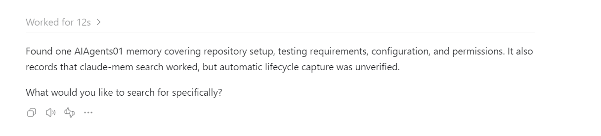

# AIAgents01

Консольная утилита на C# / .NET 8 для управления файловым обменом через внешний Windows-клиент `m_exchng.exe` (ElpClient). Описание проекта, стек и список навыков: [docs/about.md](docs/about.md).

## Как агент работает в проекте

Режим по умолчанию — `workspace-write` с `approval_policy = "on-request"`: агент самостоятельно редактирует проект и запускает разрешённые проверки, а публикация изменений через `git push` остаётся под контролем пользователя.

Агент выполняет текущую задачу в репозитории `C:\Projects\GitHub\AIAgents01`, сохраняет посторонние пользовательские изменения и сообщает, что изменил и что фактически проверил.

### Какие инструкции он читает

| Файл | Назначение |
| --- | --- |
| [AGENTS.md](AGENTS.md) | Основные инструкции репозитория: границы задачи, права, требования к проверкам и ограничения запуска обмена. |
| [.editorconfig](.editorconfig) | Стиль C#: отступы, кодировка, окончания строк и соглашения об именовании. |
| [.codex/rules/unit-tests.md](.codex/rules/unit-tests.md) | Правила тестирования, пути к тестам, требования к изоляции и команды запуска; агент читает их при работе с тестами. |
| [.agents/skills/run-and-fix-tests/SKILL.md](.agents/skills/run-and-fix-tests/SKILL.md) | Процедура автоматической проверки после изменений кода: запуск всех тестов, поиск причины падений, исправление и повторная проверка. |
| [.agents/skills/review-pull-request/SKILL.md](.agents/skills/review-pull-request/SKILL.md) | Процедура ревью PR, которую агент читает по явному запросу пользователя. |

Настройки исполнения загружает Codex: [.codex/config.toml](.codex/config.toml) задаёт режим согласования и песочницы, а [.codex/rules/permissions.rules](.codex/rules/permissions.rules) — решения для префиксов команд. Файл `unit-tests.md` содержит инструкции для агента, а не исполняемые правила доступа.

Проектный слой `.codex/` должен быть доверенным; после изменения настроек и командных правил перезапустите Codex. Политики среды и администратора могут вводить дополнительные ограничения.

### Какие у него права

| Уровень | Операции |
| --- | --- |
| **Allow — разрешено** | Запуск тестов (`dotnet test`), форматирование (`dotnet format`), создание локальных коммитов (`git commit`) в рамках текущей задачи без дополнительного вопроса о разрешении. |
| **Ask — спросить** | Каждый `git push` требует одобрения пользователя, включая варианты `--dry-run` и `--force-with-lease`. |
| **Deny — запрещено** | Переименование файлов и каталогов, включая перемещения с изменением пути: `git mv`, `Rename-Item`, `ren`, `Move-Item`, `mv` и другие способы. |

В конфигурации выбраны `approval_policy = "on-request"`, `approvals_reviewer = "user"` и `sandbox_mode = "workspace-write"`. Разрешение на команду не является поручением её выполнить: агент не создаёт коммиты и не публикует изменения только потому, что команда разрешена.

Командные правила проверяют префиксы аргументов и не являются универсальной блокировкой операций файловой системы. Поэтому `AGENTS.md` отдельно запрещает переименование через редактор, патчи, скрипты, файловые API и копирование с последующим удалением; обходить запрос согласования публикации также запрещено. Префиксы сами по себе не ограничивают рабочий каталог: операции выполняются из корня этого репозитория.

### Какие проверки его страхуют

- **Обязательная проверка после изменений кода:** перед завершением задачи агент запускает `dotnet test AIPractice1.slnx` и исправляет падения, вызванные изменениями. Нулевое число обнаруженных тестов не считается успешной проверкой.
- **Исправление причины:** навык `run-and-fix-tests` различает ошибки тестов, сборки, восстановления пакетов и среды; он запрещает удалять, пропускать или ослаблять проверки ради зелёного результата. При внешнем блокере агент сообщает причину и не утверждает, что тесты прошли.
- **Изолированный end-to-end тест:** [Tests/ProgramEndToEndTests.cs](Tests/ProgramEndToEndTests.cs) запускает настоящий `Exchange.dll` с некорректной конфигурацией и проверяет код завершения `99` и диагностику в stderr. Используются отдельный временный каталог, собственные настройки, таймаут 30 секунд и очистка ресурсов.
- **Граница реального обмена:** тест завершается до управления внешним клиентом. Агент не запускает реальный обмен без отдельно разрешённого окружения: рабочий код может завершать все процессы `m_exchng`. Успешный тест ошибки запуска не подтверждает успешность реального обмена.
- **Проверка правил доступа:** `permissions.rules` содержит примеры `match` и `not_match`; решения можно проверить через `codex execpolicy check`, не выполняя целевую команду.
- **Ревью по запросу:** `$review-pull-request` с номером или URL PR проверяет изменения на ошибки и регрессии и возвращает замечания в чат. Публикация ревью, исправления и слияние требуют отдельного запроса. Во время задачи только на ревью агент сообщает о падениях, а не исправляет код автоматически.

CI в репозитории пока не настроен: описанная процедура требует локального запуска проверок агентом. После изменения файлов C# через `apply_patch`/`Edit`/`Write` hook `PostToolUse` запускает `dotnet format whitespace AIPractice1.slnx --no-restore --include <изменённые файлы>` по `.editorconfig`. Остальные файлы, сгенерированные каталоги и пути вне репозитория пропускаются; правки через произвольные shell-команды и внешние редакторы этим hook не отслеживаются. Ошибка форматтера возвращается агенту для исправления.

Hook настроен в [.codex/config.toml](.codex/config.toml), обработчик — [.codex/hooks/format_after_edit.py](.codex/hooks/format_after_edit.py); требуется Python 3.12 с Windows launcher `py` и .NET SDK. Перед использованием восстановите зависимости через `dotnet restore AIPractice1.slnx`, перезапустите Codex и в `/hooks` проверьте и разрешите новый hook; до подтверждения доверия он пропускается. Команда обработчика привязана к текущему пути репозитория. Для проверки форматирования без перезаписи файлов используйте `dotnet format AIPractice1.slnx --verify-no-changes`.

Проверки обработчика: `py -3.12 -m unittest discover -s .codex/hooks/tests -v`.

### Как запустить тесты

Нужен SDK с поддержкой `net8.0`; для команд с `AIPractice1.slnx` также нужна поддержка формата `.slnx` (например, установленный .NET 10 SDK). Команды выполнять из корня репозитория.

Все тесты решения:

```powershell
dotnet test AIPractice1.slnx
```

Только тестовый проект, в том числе с SDK без поддержки `.slnx`:

```powershell
dotnet test Tests/Exchange.Tests.csproj
```

Существующий end-to-end тест отдельно:

```powershell
dotnet test Tests/Exchange.Tests.csproj --filter "FullyQualifiedName~Exchange.Tests.ProgramEndToEndTests"
```

`dotnet test` восстанавливает NuGet-пакеты и собирает проекты, если не указаны параметры, отключающие эти этапы. При первом запуске нужен доступ к источникам пакетов. Дополнительные сведения: [Tests/README.md](Tests/README.md).

Проверить, что публикация требует согласования, без выполнения `git push`:

```powershell
codex execpolicy check --rules .codex/rules/permissions.rules --pretty -- git push origin HEAD
```

Ожидаемое решение проверяющего инструмента — `prompt`.
# Screenshots

